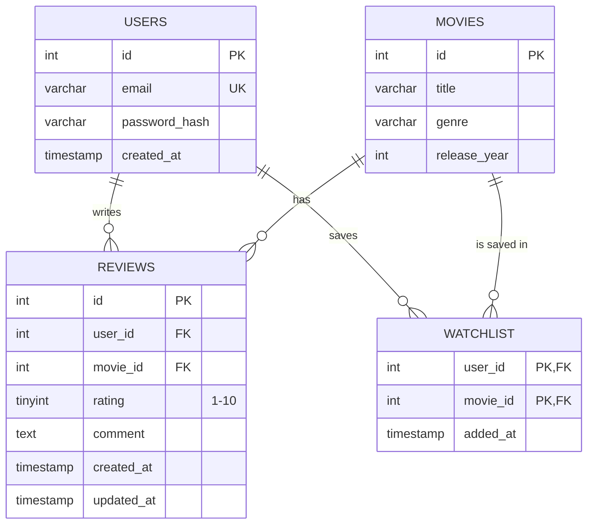

# FilmRecension API

A REST API for a movie platform where people can browse movies, read and write reviews, and keep a personal watchlist. Backend only (no frontend), built with **Node.js, Express, MySQL** and **JavaScript**.

## Features

- **Accounts:** register and log in with email and password. Passwords are hashed with bcrypt; login returns a JWT.
- **Movies:** anyone can list all movies or get one movie.
- **Reviews:** anyone can read reviews. Signed-in users can review a movie (rating 1–10 + comment) and edit **only their own** reviews.
- **Watchlist:** signed-in users can view, add to and remove from **their own** list of saved movies.

## Tech stack

| Package | Used for |
|---|---|
| express 4 | web server and routes |
| mysql2 | talking to MySQL with parameterised queries |
| bcrypt | hashing passwords |
| jsonwebtoken | creating and verifying login tokens (JWT) |
| dotenv | loading secrets from `.env` |

## Project structure

```
filmrecensionuppgift/
├── database/setup.sql      # creates the database, tables and sample movies
├── middleware/requireAuth.js  # checks the JWT on protected routes
├── models/                 # classes that talk to the database
│   ├── Movie.js
│   ├── Review.js
│   ├── User.js
│   └── Watchlist.js
├── routes/                 # URL handlers
│   ├── auth.js
│   ├── movies.js
│   ├── review.js
│   └── watchlist.js
├── utils/validate.js       # shared input validation
├── db.js                   # MySQL connection pool
├── server.js               # starts the app
└── .env.example            # template for your own .env
```

## Installation

**Requirements:** Node.js 18 or newer, MySQL 8.

1. Clone the repository and install packages:
   ```
   git clone https://github.com/eliassjoholm/filmrecensionuppgift.git
   cd filmrecensionuppgift
   npm install
   ```
2. Create your own `.env` from the template and fill in your MySQL password and a JWT secret:
   ```
   copy .env.example .env
   ```
   Generate a random JWT secret with:
   ```
   node -e "console.log(require('crypto').randomBytes(32).toString('hex'))"
   ```

## Database setup

Run the setup script. It creates the `filmrecension` database, all four tables and 5 sample movies.
**Warning:** it deletes an existing `filmrecension` database first.

```
mysql -u root -p -e "source database/setup.sql"
```

(On Windows, if `mysql` is not in your PATH, use the full path, for example
`"C:\Program Files\MySQL\MySQL Server 8.4\bin\mysql.exe"`.)

Users are **not** inserted by the script. Register them through the API so their passwords are hashed.

## Start

```
npm start        # normal start
npm run dev      # restarts automatically when files change
```

The API runs on `http://localhost:3000`.

## ER diagram



- One user can write many reviews and save many movies.
- One movie can have many reviews and be in many watchlists.
- `reviews (user_id, movie_id)` is **UNIQUE**: one review per user per movie.
- `watchlist (user_id, movie_id)` is the **primary key**: the same movie can't be saved twice.
- All foreign keys use `ON DELETE CASCADE`: deleting a user or movie also deletes their reviews and watchlist rows.

## API routes

| Method | Route | Purpose | Auth |
|---|---|---|---|
| POST | `/api/auth/register` | Create an account | Public |
| POST | `/api/auth/login` | Log in and receive a token | Public |
| GET | `/api/movies` | List movies | Public |
| GET | `/api/movies/:id` | Get one movie | Public |
| GET | `/api/movies/:movieId/reviews` | List a movie's reviews | Public |
| POST | `/api/movies/:movieId/reviews` | Create a review | Signed in |
| PUT | `/api/reviews/:id` | Update own review | Owner |
| GET | `/api/watchlist` | List my saved movies | Signed in |
| POST | `/api/watchlist/:movieId` | Save a movie | Signed in |
| DELETE | `/api/watchlist/:movieId` | Remove a saved movie | Signed in |

Protected routes need the header:
```
Authorization: Bearer <token from login>
```

### Request bodies

**Register / login**
```json
{ "email": "anna@test.com", "password": "password123" }
```
Email must be valid; password must be 8–72 characters.

**Create / update review**
```json
{ "rating": 8, "comment": "Great movie!" }
```
Rating must be a whole number from 1 to 10; comment is required (max 1000 characters).

### Status codes

| Code | Meaning in this API |
|---|---|
| 200 | OK |
| 201 | Created (account, review, watchlist item) |
| 400 | Invalid input: bad id, email, password, rating or comment |
| 401 | Not logged in, or invalid/expired token |
| 403 | Logged in, but trying to edit someone else's review |
| 404 | Movie, review, watchlist item or route not found |
| 409 | Duplicate: email already registered, movie already reviewed, movie already in watchlist |
| 500 | Unexpected server error (details are logged, never sent to the client) |

## Design choices

- **One review per user per movie.** Enforced by a UNIQUE constraint in the database and answered with 409 by the API. To change their opinion, users edit their review instead.
- **PUT instead of PATCH** for editing a review: the client always sends the full review (rating + comment), so the whole review is replaced.
- **OOP:** each table has a model class (`Movie`, `User`, `Review`, `Watchlist`) that holds all SQL for that table. Routes only handle HTTP (input, status codes, responses). `Review` has instance methods like `isOwnedBy()` and `update()`; a `Watchlist` object is created for one user and can only touch that user's rows.
- **Validation in two layers:** the API validates input and returns clear messages, and the database adds constraints (`NOT NULL`, `UNIQUE`, `CHECK rating BETWEEN 1 AND 10`, foreign keys) as a safety net.

## Security

- **Passwords** are hashed with bcrypt (10 salt rounds) and never returned by the API.
- **SQL injection** is prevented with parameterised queries (`WHERE id = ?`); client input is never concatenated into SQL.
- **JWT:** login returns a token signed with `JWT_SECRET` (valid 1 hour). `requireAuth` verifies it on protected routes and puts the user's id on `req.user`.
- **The user id always comes from the verified token**, never from the request body or URL. That is how the watchlist and review ownership are protected.
- **Review ownership** is checked before updating (403 if not the owner).
- **Login** gives the same error for unknown email and wrong password, so attackers can't find out which emails are registered.
- **Secrets** (database password, JWT secret) live in `.env`, which is excluded by `.gitignore`. `.env.example` only contains placeholders.
- **Errors:** SQL errors are logged on the server, and the client only gets a generic message.

## Possible improvements

- A separate MySQL user with access only to the `filmrecension` database, instead of `root` (least privilege).
- Rate limiting on login to slow down password-guessing attacks.
- Refresh tokens, or storing the JWT in an httpOnly cookie, for a real frontend.
- Admin role and routes to add, update and delete movies.
- Average rating per movie with `AVG()` and `JOIN`, search, genre filter and pagination.
- A username or display name so reviews show who wrote them, without exposing emails.
- Automated tests (for example with Jest + Supertest).